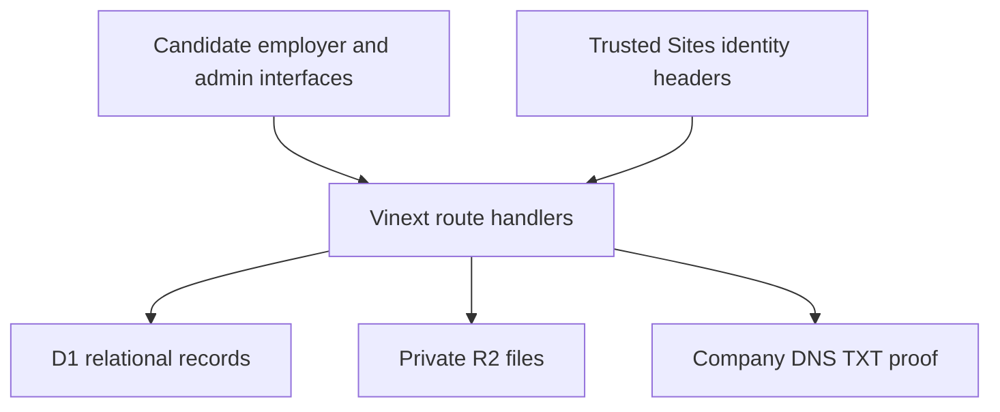

# Align architecture

Align has a public live hiring area and a separate fictional sample workspace. A candidate and an employer must both express interest before live messaging and interview booking become available.

## Source map

| Area | Files | Responsibility |
| --- | --- | --- |
| Main experience | `app/page.tsx`, `app/data.ts`, `app/globals.css`, `app/live.css` | Sample discovery, navigation, profiles and shared styling |
| Live hiring | `app/components/live-hiring.tsx`, `app/lib/live-server.ts`, `app/lib/live.ts` | Candidates, company teams, preferences, applications, messages, slots and interviews |
| Identity review | `app/components/verification.tsx`, `app/lib/verification.ts` | Admin review, profile photos, private ID images and mandatory company approval |
| Career tools | `app/components/premium-career.tsx`, `app/components/career-coach.tsx`, `app/lib/career.ts`, `app/lib/docx.ts` | Listed-skill coverage, editable drafts, DOCX export and guided practice |
| HTTP API | `app/api/` | Live hiring, verification, private workspace and resume storage endpoints |
| Data model | `db/schema.ts`, `drizzle/` | Drizzle schema and four ordered SQL migrations with schema snapshots |
| Runtime | `worker/index.ts`, `vite.config.ts`, `app/chatgpt-auth.ts` | Cloudflare Worker routing, local bindings and platform sign-in integration |
| Checks | `scripts/check-*.cjs` | API isolation, career logic, SQLite-backed live workflows and verification lifecycle |

## State and ownership

D1 stores companies, accepted team memberships, candidate profiles, jobs, applications, messages, availability, interviews, notifications, settings, verification records and private workspace JSON. R2 stores private resumes, staged portraits and ID images. Generated career documents are not included in live candidate responses.

Every live operation checks candidate ownership, company membership or administrator authority on the server. Candidate publication is opt-in. Contact-sharing preferences and company/domain blocks apply on reads and writes; adding a block withdraws affected applications and cancels future interviews.

Jobs expire after 30 days without reconfirmation. Posting and reopening require both domain control and separate admin approval. Verification badges express those checks, rather than guaranteeing every employer claim.

## Identity boundary

The hosted app receives trusted `oai-authenticated-user-*` headers from Sites. Its local development plugin uses an isolated loopback-only test identity and strips incoming identity headers before supplying the local identity. The application does not implement an independent public OAuth service. A deployment outside Sites needs a trusted identity gateway that strips untrusted headers and supplies verified identities.

`ALIGN_ADMIN_EMAILS` is server-only configuration. No production value is included in this export. Private ID images are authorized per request, expire after seven days when pending, and are deleted after review or withdrawal. Failed deletion attempts enter a retry queue. Reviews are manual; the app does not perform automated facial recognition.

## Matching and career tools

Live matching is reciprocal interest. The Plus preview uses explicit skill lists, aliases, rules and templates. It does not call an AI model, infer hiring probability, parse uploaded resumes, collect payments, send email, or synchronize external calendars. Calendar support is an ICS download.

## Export provenance

The application files were exported from Align's current source on October 29, 2026. The snapshot is `d3fa38301c61ceaa0c51bf6723b51d5192c4c11d`. The GitHub copy removes the hosted Site identity, gives the package an Align-specific name, adds convenience check/local-migration scripts and adds project documentation. Production application behavior is preserved.

This export contains source, schema migrations and synthetic test fixtures. Runtime database contents, uploaded files, credentials and local build state are excluded. Third-party license files remain alongside their vendored assets.
